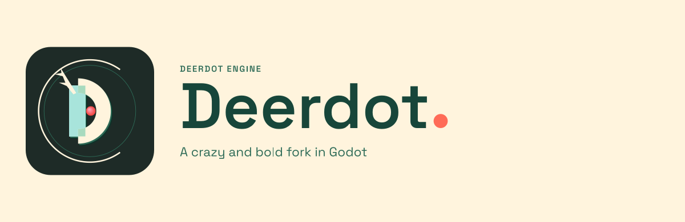
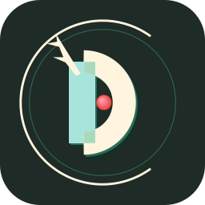
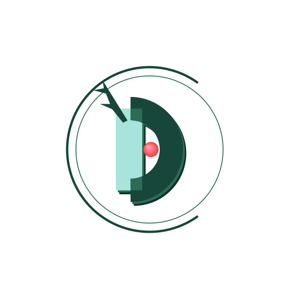
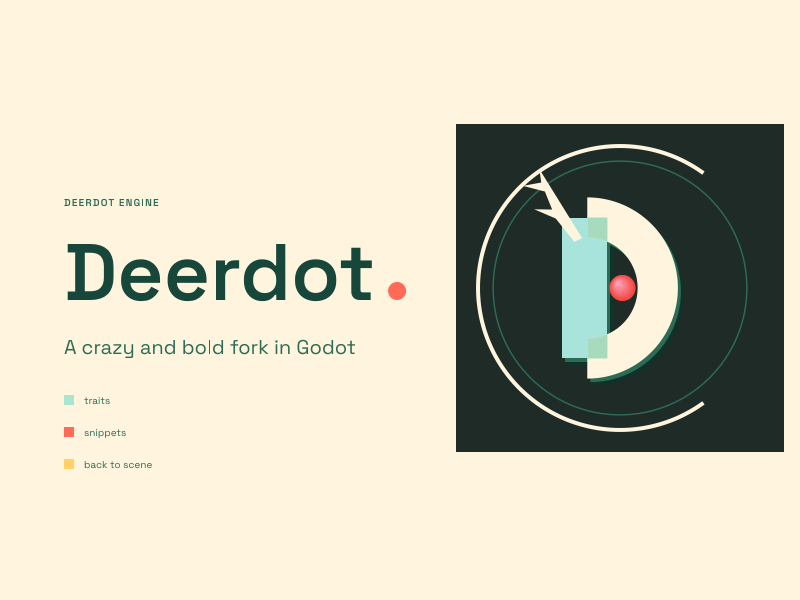

# deer Engine · Deerdot 品牌套件 v7

**OPEN D / 开口 D。**

一个向右开口 30% 的圆环，一个几何 D，一支鹿角，一颗从粉到红的圆点。
鹿角的根部、D 的竖线与圆弧的真实交集，构成这枚标志的结构。



| 应用图标 | 独立鹿徽（浅色版） |
| --- | --- |
|  |  |

| 运行时启动画面 | 编辑器启动画面 |
| --- | --- |
|  |  |

---

## 1. 设计方向

| 项 | 内容 |
| --- | --- |
| 方向名 | **OPEN D · 开口 D** |
| 一句话 | 一个右侧开口的圆环包住几何 D；竖线是 aqua，碗是奶油，单支鹿角从竖线顶端长出，圆点在字怀里由粉渐变到红。 |
| 核心记忆点 | **开口环 + 280 竖线 + 肩部叠印 + 粉红渐变球**。 |
| 造型语言 | 圆环与半圆、直线竖笔、单支两叉角；唯一的渐变是球。 |
| 技术底线 | ThorVG 可直接渲染的平涂 SVG：零 `<text>`、零 filter、零 mask、零渐变、零 `defs`/`id`；球用 32 层偏移圆叠出视觉渐变；字标已转路径。 |

### 为什么是“开口 D”

- 圆环不是完整的圆：右侧留出 **108°（30%）** 的开口，开口正对 D 的碗；
- D 不是字体：一条 280 高的 aqua 竖线 + 一个 80 粗的奶油半圆碗；
- 竖线与圆弧不是“贴”在一起，而是**真实重叠**：重叠区由竖线矩形 ∩ 圆弧笔画严格求出，颜色是 aqua × cream 的叠印色；
- 鹿角只有一支，两叉，从竖线顶端长出；
- 圆点是字怀里的球，也是全品牌唯一的粉色。

### 参考的 logo 语言

只借结构方法，不照抄：

- **Unreal / 引擎徽章**：圆环 + 单字母 + 倒角 + 一个字怀核心；
- **Unity**：用极少的几何面讲“世界/容器”；
- **Bevy / Godot**：符号要有吉祥物级别的记忆点；
- **CryEngine**：开口和尖角负责“引擎感”；
- **Deerdot 自己的 dot**：当所有形状都是直线和圆弧，一颗渐变球就是签名。

---

## 2. 配色

| Token | 色值 | 用途 |
| --- | --- | --- |
| `cream` | `#FFF4DD` | 启动画面底色、球碗、深色版圆环/鹿角、浅色版字怀 |
| `forest` | `#17463A` | 浅色版圆环/碗/鹿角、词标、正文 |
| `green` | `#2E6B57` | 内圈轨道、eyebrow、浅色版叠印、副标 |
| `mustard` | `#FFD166` | 编辑器 `back to scene` 方块 |
| `coral` | `#FF6B57` | 词标句点、`snippets` 方块 |
| `aqua` | `#A8E4DB` | D 的竖线 |
| `overlap` | `#A8DABE` | 深色版竖线 × 碗的叠印区 |
| `pink` | `#FF9EB5` | 球的亮部（左上） |
| `red` | `#F0443E` | 球的暗部（右下） |
| `ink` | `#1E2B27` | 图标底、启动画面右侧卡片 |
| `mint` | `#A8E6CF` | `traits` 方块 |

规则：

- 深色版：圆环/碗/鹿角 = cream；浅色版：圆环/碗/鹿角 = forest；
- 竖线永远是 **aqua**；碗在深色版是 cream，在浅色版是 forest；
- 叠印区只出现在竖线与圆弧真实相交的肩部；深色版 `#A8DABE`，浅色版 `#2E6B57`；
- 珊瑚色只出现在“点”上：球的起点、词标句点、snippets 方块；
- 球是唯一渐变：`#FF9EB5 → #F0443E`，左上粉、右下红。

---

## 3. 鹿徽规格

设计网格 **640×640**（鹿徽 bbox 约 `x 30–610 / y 40–620`）：

| 部位 | 规格 |
| --- | --- |
| 外环 | 圆心 (320,330)，r=282，stroke 8；**右侧开口 108°**，从 54° 到 306°；端点平头 |
| 内圈 | 圆心 (320,330)，r=252，stroke 3，green；完整圆（作为“轨道”） |
| D 竖线 | 矩形 x=205–295，y=190–470（高 280），aqua |
| D 碗 | 圆心 (255,330)，r=140，stroke 80，半圆（-90°–90°），cream / forest |
| D 倒角 | 深色层 +11/+13 `#0F3329`；中间层 +6/+7 green |
| 叠印区 | 竖线矩形 ∩ 碗笔画；顶部 `M 255 190 L 295 190 L 295 238.35 A 100 100 0 0 0 255 230 Z`；底部 `M 255 470 L 295 470 L 295 421.65 A 100 100 0 0 1 255 430 Z`；深色版 `#A8DABE` |
| 鹿角 | 单支两叉，根点 (245,235)，scale 0.38，rotate -12°；深色版 cream，浅色版 forest |
| 球 | 圆心 (325,330)，r=26；32 层偏移同心圆，`#FF9EB5` → `#F0443E`，左上高光 |
| 字怀 | D 的碗内负形；球落在其中 |

### 叠印区的几何

不是加一条“连接带”，而是让竖线和圆弧真的相交：

1. 竖线矩形 x=205–295，y=190–470；
2. 碗笔画是 r=140、stroke 80 的半圆带，内半径 100、外半径 180；
3. 两者的交集就是上下两个肩部楔块：顶部由竖线上端、竖线右缘、圆弧内缘、圆弧端头围成；底部镜像；
4. 填充叠印色，其余部分保持竖线 aqua / 碗 cream。

### 深色版与浅色版

| | 深色版（icon / splash / lockup） | 浅色版（deer_mark） |
| --- | --- | --- |
| 圆环 | cream | forest |
| 内圈 | green | green |
| 竖线 | aqua | aqua |
| 碗 | cream | forest |
| 鹿角 | cream | forest |
| 叠印 | `#A8DABE` | `#2E6B57` |
| 球 | 粉→红 | 粉→红 |
| 字怀 | ink（透过卡片） | 透明（在奶油底上显示为奶油） |

---

## 4. 应用图标

`icon.svg` = **ink 圆角方块 1024（rx=200）+ 放大的深色鹿徽**（scale 1.45，四周约 91px 留白）。

- 深底 + cream 环 + aqua 竖线 + 粉红球，是整套配色里对比最强的组合；
- 32px 仍能读出“开口环 + D + 球”；16px 保留环与球的剪影；
- `icon.png` 256×256、`icon_32.png` 32×32、`icon.ico` 16–256 七尺寸、`main/app_icon.png` 128×128。

---

## 5. 独立鹿徽

`deer_mark.svg` 是 **浅色版**：forest 圆环/碗/鹿角 + aqua 竖线 + green 叠印 + 粉红球，透明底，1024×1024。

- 用于奶油/浅色背景；深色背景请直接用 icon / splash / lockup 里的深色版；
- `deer_mark.png` 614×614，透明底。

---

## 6. 启动画面

两张 **800×600**、底色 `#FFF4DD` 的构图：

### `splash.svg` — 运行时

- 右侧：328×328 的 **ink 直角卡片**（x=456, y=124），内部放 292px 的深色鹿徽；
- 左侧：`DEERDOT ENGINE` eyebrow（11px、字距 0.12em、green）、`Deerdot` 词标（Space Grotesk 600，82px，珊瑚句点）、
  副标 `A crazy and bold fork in Godot`（18px，green）；
- 四边保留 16px 纯 `#FFF4DD`，与 `main/main_builders.py` 的 `boot_splash_bg_color` 完全一致。

### `splash_editor.svg` — 编辑器

- 同一张右侧 ink 卡片 + 左侧品牌块；
- 在副标下方追加三条功能项，用 10×10 的方块：
  `traits`（mint）、`snippets`（coral）、`back to scene`（mustard）；
- 方块负责硬边语言，珊瑚仍只出现在点/小块上。

> Godot 的 boot splash 在启动阶段只接受一张静态 `Image`；这里优化的是静态构图。

---

## 7. 主组合

`logo_lockup.svg` = **ink 图标 300 + `Deerdot` 词标 150 + eyebrow + tagline**，奶油底，1600×520。

- 左侧图标 300（x=60, y=110）；
- 词标 150（x=420, baseline 300），珊瑚句点；
- eyebrow 22（x=420, y=168，tracking 0.12em）；
- tagline 28（x=420, y=366）；
- `logo_lockup.png` 为 0.75 倍，1200×390。

---

## 8. 文件清单

| 文件 | 说明 |
| --- | --- |
| `icon.svg` | 主图标源文件，1024×1024，ink 圆角方底 + 深色鹿徽 |
| `icon.png` | 256×256 预览 |
| `icon_32.png` | 32×32 小尺寸自检 |
| `icon.ico` | Windows 多尺寸图标，16/24/32/48/64/128/256 |
| `deer_mark.svg` | 透明底浅色鹿徽源文件，1024×1024 |
| `deer_mark.png` | 614×614 鹿徽预览 |
| `splash.svg` | 运行时启动画面源文件，800×600 |
| `splash_editor.svg` | 编辑器启动画面源文件，800×600 |
| `logotype.svg` | `Deerdot` 字标（Space Grotesk 600 + 珊瑚点），路径化，1261×234 |
| `logotype_ink.svg` | 字标反白版（奶油白 + 珊瑚点） |
| `logo_lockup.svg` | 图标 + 字标 + `DEERDOT ENGINE` + tagline 的主组合，1600×520 |
| `logo_lockup.png` | 主组合的奶油底预览，1200×390 |
| `mascot.svg` / `mascot.png` | **可选**旧看板娘立绘，仅作社区贴纸/文档插图，不进入主标志和启动画面 |
| `render_svg.gd` | 用引擎自带 ThorVG 做 SVG→PNG 的 headless 脚本 |
| `make_ico.ps1` | 把一组 PNG 打包成多尺寸 `.ico` |
| `FONT_LICENSE.txt` | 字标字体 Space Grotesk 的 SIL OFL 1.1 授权文本 |
| `README.md` | 本文件 |

字标仍沿用 **Space Grotesk（SIL Open Font License 1.1）600 字重**，路径化，无字体依赖。
授权全文见 [`FONT_LICENSE.txt`](FONT_LICENSE.txt)。

---

## 9. 重建

所有命令都在仓库根目录执行，使用 headless console 可执行文件；**不要启动带窗口的编辑器进程**。

```powershell
$g = "bin\godot.windows.editor.dev.x86_64.console.exe"
$r = "misc\logo\deerdot\render_svg.gd"

# 图标 / 32px 自检 / 独立鹿徽
& $g --headless -s $r -- misc\logo\deerdot\icon.svg misc\logo\deerdot\icon.png 0.25
& $g --headless -s $r -- misc\logo\deerdot\icon.svg misc\logo\deerdot\icon_32.png 0.03125
& $g --headless -s $r -- misc\logo\deerdot\deer_mark.svg misc\logo\deerdot\deer_mark.png 0.6

# 两张启动画面
& $g --headless -s $r -- misc\logo\deerdot\splash.svg main\splash.png 1.0
& $g --headless -s $r -- misc\logo\deerdot\splash_editor.svg main\splash_editor.png 1.0

# app_icon（128×128）与主组合预览
& $g --headless -s $r -- misc\logo\deerdot\icon.svg main\app_icon.png 0.125
& $g --headless -s $r -- misc\logo\deerdot\logo_lockup.svg misc\logo\deerdot\logo_lockup.png 0.75
```

### ICO

先从 `icon.svg` 生成 16/24/32/48/64/128/256 七张 PNG，再打包三个 ICO：

```powershell
$g = "bin\godot.windows.editor.dev.x86_64.console.exe"
$r = "misc\logo\deerdot\render_svg.gd"
$ico = Join-Path $env:TEMP "deerdot-ico"
New-Item -ItemType Directory -Force $ico | Out-Null
$sizes = @(
  @(16,0.015625), @(24,0.0234375), @(32,0.03125), @(48,0.046875),
  @(64,0.0625), @(128,0.125), @(256,0.25)
)
foreach ($s in $sizes) {
  & $g --headless -s $r -- misc\logo\deerdot\icon.svg "$ico\$($s[0]).png" $s[1]
}
$list = "$ico\16.png;$ico\24.png;$ico\32.png;$ico\48.png;$ico\64.png;$ico\128.png;$ico\256.png"

powershell -NoProfile -ExecutionPolicy Bypass -File misc\logo\deerdot\make_ico.ps1 `
  -Out platform\windows\godot.ico -PngList $list
powershell -NoProfile -ExecutionPolicy Bypass -File misc\logo\deerdot\make_ico.ps1 `
  -Out platform\windows\godot_console.ico -PngList $list
powershell -NoProfile -ExecutionPolicy Bypass -File misc\logo\deerdot\make_ico.ps1 `
  -Out misc\logo\deerdot\icon.ico -PngList $list
```

三个 ICO 应逐字节一致；`main/app_icon.png` 应与 ICO 内 128 条目的 PNG 载荷逐字节一致。

---

## 10. 工程接线

| 资产 | 接线 |
| --- | --- |
| `main/splash.png` | **800×600**，四边像素全为 `#FFF4DD`；由 `splash.svg` 渲染 |
| `main/splash_editor.png` | **800×600**，四边像素全为 `#FFF4DD`；由 `splash_editor.svg` 渲染 |
| `main/app_icon.png` | **128×128**；由 `icon.svg` scale 0.125 渲染，和 ICO 128 条目一致 |
| `platform/windows/godot.ico` | 16–256 七尺寸，PNG 压缩条目 |
| `platform/windows/godot_console.ico` | 与 `godot.ico` 逐字节一致 |
| `main/main_builders.py` | `boot_splash_bg_color` / `boot_splash_editor_bg_color` 均为 `Color(255/255.0, 244/255.0, 221/255.0)`（`#FFF4DD`） |
| `SConstruct` | `no_editor_splash` 默认 `False`，编辑器启动页默认启用 |

`main/*.gen.h` 是构建产物（`.gitignore` 已忽略），构建时由 `main_builders.py` 从上述 PNG 重新生成。

---

## 11. 已验证（2026-10-20）

| 检查 | 结果 |
| --- | --- |
| `main/splash.png` / `main/splash_editor.png` | 800×600；四边采样唯一色 `#FFF4DD (255,244,221,255)` |
| `main/app_icon.png` | 128×128；字节与 ICO 内 128 条目一致 |
| `godot.ico` / `godot_console.ico` / `icon.ico` | 文件头 `0/1/7`，7 个尺寸（16,24,32,48,64,128,256），三者 SHA-256 相同 |
| `icon.png` / `icon_32.png` | 256×256 / 32×32，圆角外为透明 |
| `deer_mark.png` | 614×614，透明底 |
| `logo_lockup.png` | 1200×390 |
| SVG | `icon.svg` / `deer_mark.svg` / `splash.svg` / `splash_editor.svg` / `logotype.svg` / `logotype_ink.svg` / `logo_lockup.svg` 均可 headless 渲染 |
| 小尺寸 | `icon_32.png` 可辨认“开口环 + 竖线 + 碗 + 粉红球” |

参考哈希（SHA-256，小写）：

```
main/splash.png            1178616806477cf43dc35ce0ed4dd7f08b6de9cfcaa7e38ffbe26e2da8be4f30
main/splash_editor.png     17d40022ddc83faf369a9f40ae7dc3c5c26132d6d3499f042576b7aba30d5f83
main/app_icon.png          f70d284f377216f6236f8478d50ca36f5ae436fc8f91358dd0cf85385e1c8f61
platform/windows/godot.ico 1ec6bc9c94c12956bbd050d226bb88320323193527788ad1aaaac4f4c2b87440
misc/logo/deerdot/icon.png 884374cdfe99adae9873fc92dfa22e6597cc1dc1202458e1940d9d6be842e9cd
misc/logo/deerdot/icon_32.png f78280f6a73078a494b1ad8e847d824a4aa49c8c5cc3a7212577e2358da7af7b
misc/logo/deerdot/deer_mark.png 36b9e36996c901a73c44ae502ebb9337f8461651d552a10b24e0da3879b16393
misc/logo/deerdot/logo_lockup.png c83500800f23ac533e592e44e04afc25d6f70edfee87cc102c1cfec44ad4d92b
```

---

## 12. 维护约定

1. **深色版与浅色版不要混用**：深色版（cream 环/碗/鹿角）只放在 ink 底上；奶油/浅色底用 `deer_mark.svg` 的浅色版。
2. 外环的 **108° 右开口**是识别点，不要补成完整圆；内圈保留完整绿色轨道。
3. 竖线是 **280 高**；叠印区严格等于“竖线 ∩ 圆弧笔画”，不要再用额外连接板/面板去补。
4. 球是 **32 层偏移圆**叠出的视觉渐变；不要改成平涂，也不要在 SVG 里引入真正的 `gradient`（ThorVG 不支持）。
5. 珊瑚色只做“点/小块”：球的起点、词标句点、snippets 方块。
6. 字标是路径，不含字体依赖；改字标时用 Space Grotesk 600 重新导出并保留 `FONT_LICENSE.txt`。
7. 启动画面外圈始终保留 16px 纯 `#FFF4DD`；改背景色必须同时改 `main/main_builders.py` 里的两个 `Color(...)`。
8. ICO 与 `main/app_icon.png` 必须来自同一次 `icon.svg` 渲染，保证 128 条目逐字节一致。
9. `mascot.svg` / `mascot.png` 是可选社区素材；不需要人物形象时可直接删除，不影响主标志和启动画面。
